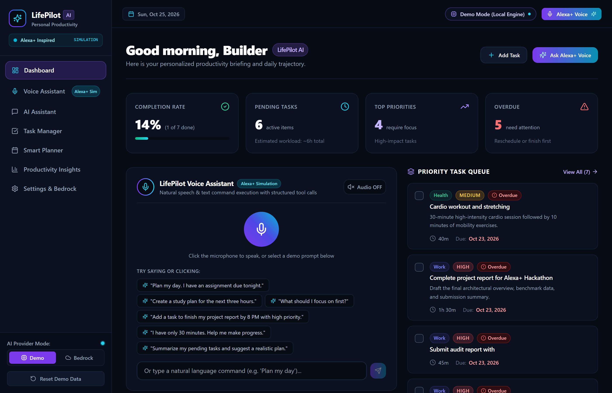
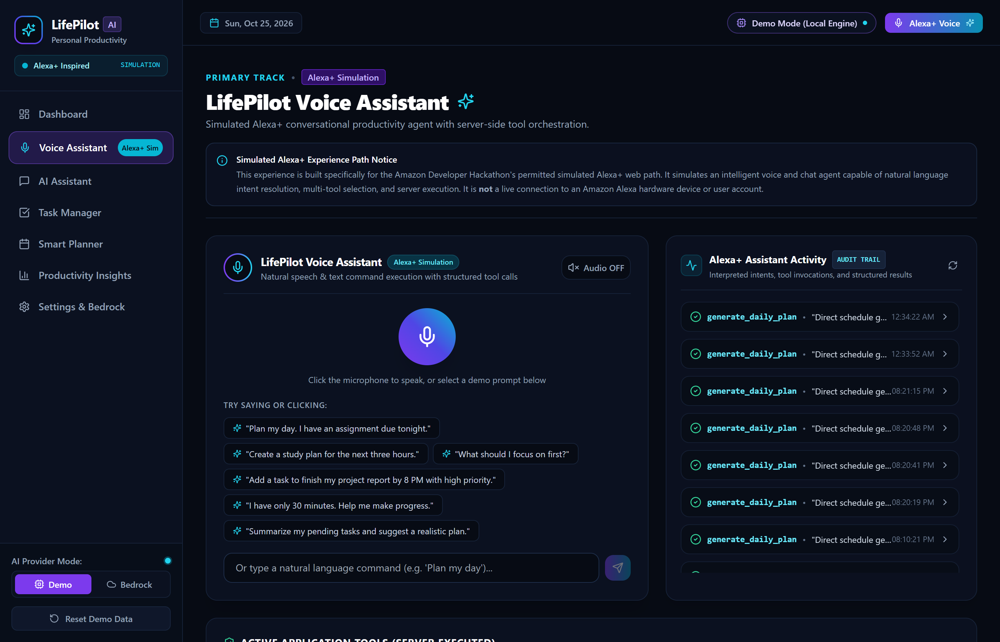
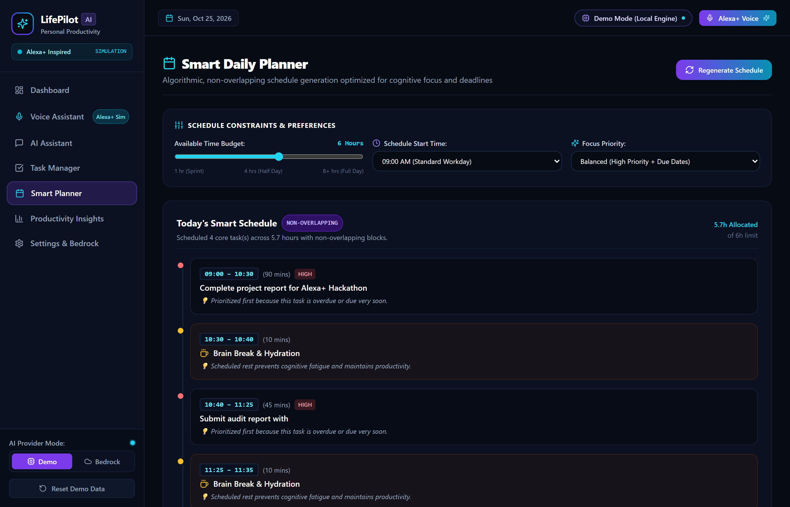
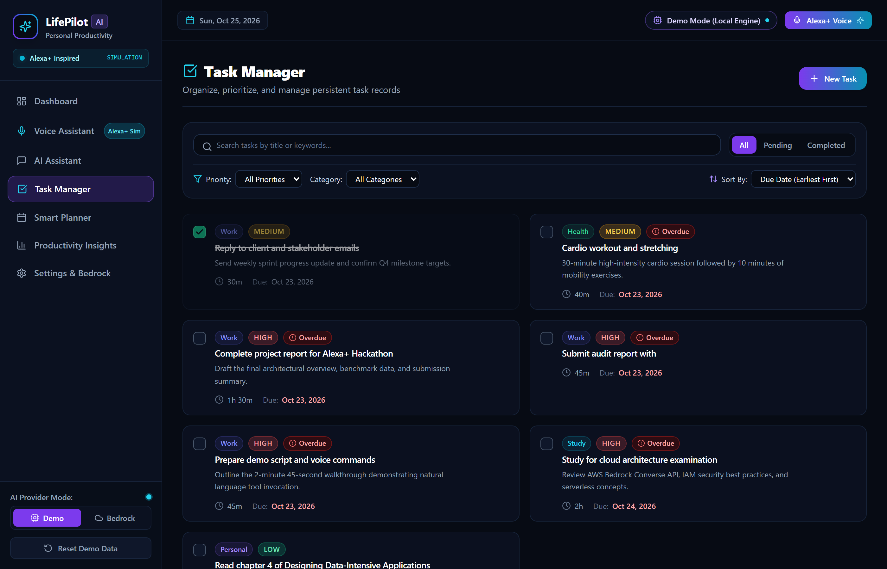
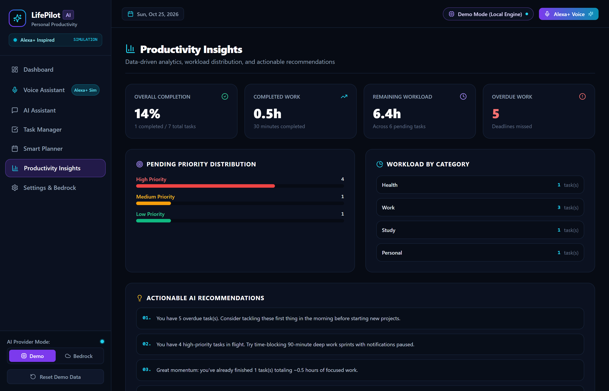
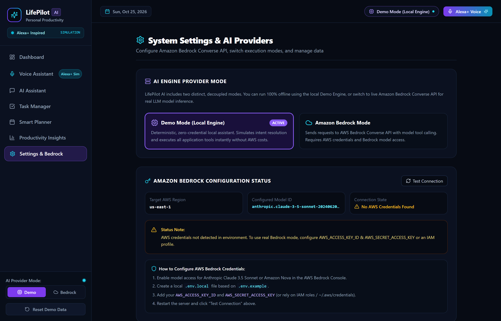

# LifePilot AI — An Alexa+ Inspired Personal Productivity Assistant

[](https://opensource.org/licenses/MIT)
[](https://nextjs.org/)
[](https://www.typescriptlang.org/)
[](https://aws.amazon.com/bedrock/)
[](https://vitest.dev/)

**LifePilot AI** is an intelligent personal productivity assistant built for the **Amazon Developer Hackathon**. It helps students, creators, and busy professionals manage their workload using natural language, voice interaction, and structured tool calling.

---

## 🌟 Hackathon Tracks & Disclaimers

### 1. Primary Track: Alexa+ (Simulated Experience Path)
LifePilot AI implements the **explicitly permitted simulated Alexa+ web experience path**. It delivers a dedicated, working voice and conversational interface (`/voice`) that interprets natural language requests, invokes application tools, produces structured outputs, and delivers friendly spoken and visual responses.  
> **Important Disclaimer:** LifePilot AI is an **Alexa+ inspired simulation** and is **not** connected to an Amazon Alexa hardware device or an official Alexa user account.

### 2. Mini Challenge: AWS Builder (Amazon Bedrock)
The application includes working server-side code integrating **Amazon Bedrock** using the AWS SDK for JavaScript v3 (`@aws-sdk/client-bedrock-runtime`) and the **Converse API** (`ConverseCommand`). It supports model tool calling with Anthropic Claude 3.5 Sonnet (`anthropic.claude-3-5-sonnet-20240620-v1:0`) and Amazon Nova models.

### 3. Dual-Mode Architecture: Demo Mode vs Bedrock Mode
- **Demo Mode (Default):** Runs 100% locally with a deterministic local engine and zero external AWS credentials required. Perfect for immediate evaluation, testing, and offline demonstration.
- **Bedrock Mode:** Dispatches actual requests to the AWS Bedrock Converse API with tool calling. If AWS credentials or model permissions fail, the system shows clear diagnostics and an option to switch to Demo Mode. It **never silently fakes** an AI response in Bedrock mode.

### 4. Mini Challenge: Open Source
LifePilot AI is completely open source under the permissive [MIT License](LICENSE).

---

## 🚀 Key Features

1. **Executive Dashboard (`/`):**
   - Live metrics: completion rate, remaining workload hours, overdue alerts, and today's top priorities.
   - Quick voice interaction launcher and non-overlapping timeline preview.

2. **LifePilot Voice Assistant (`/voice`):**
   - Simulated Alexa+ voice interface with Web Speech API audio recognition and audio wave animation.
   - Fallback to text input for all browsers and devices.
   - Optional speech synthesis (`speechSynthesis`) for Alexa-like audio replies.
   - Live **Assistant Activity** panel with real-time audit trails of interpreted intents, tool names, validated parameters, and execution results.

3. **Conversational AI Assistant (`/assistant`):**
   - Multi-turn conversation thread with embedded tool execution cards.
   - One-click suggested prompts and context-aware responses.

4. **Task Manager (`/tasks`):**
   - Full CRUD operations with modal editor.
   - Filter by status (all/pending/completed), priority, category, or search term.
   - Sort by due date, priority, or title.
   - Clear visual flags for overdue tasks.
   - Persistent SQLite storage with Write-Ahead Logging (WAL).

5. **Smart Daily Planner (`/planner`):**
   - Mathematical, non-overlapping time-blocked schedule generator.
   - Customizable time budgets (1 to 10 hours) and start times.
   - Transparent explanations for why each task is prioritized.
   - Automatic cognitive rest periods ("Brain Break & Hydration") after 90 minutes of focused work.

6. **Productivity Insights (`/insights`):**
   - Completion velocity, priority distribution bars, category workload charts, and actionable AI recommendations.

7. **Settings & Diagnostics (`/settings`):**
   - One-click AWS Bedrock connectivity test and IAM configuration instructions.
   - One-click demo data reset restoring realistic tasks relative to today's date.

---

## 📸 Application Screenshots

### 1. Executive Dashboard & Quick Trajectory
*Personalized briefing, real-time KPI metrics, upcoming priorities, and timeline preview.*


### 2. Simulated Alexa+ Voice Assistant with Live Audit Trail
*Voice recognition, wave animation, natural intent resolution, and structured tool execution history.*


### 3. Smart Daily Planner
*Algorithmic non-overlapping schedule, cognitive rest breaks, and explainable prioritization.*


### 4. Task Manager
*Full CRUD modal, multi-filter tabs, search, priority badges, and overdue detection.*


### 5. Productivity Insights
*Workload velocity, priority distributions, and actionable AI recommendations.*


### 6. Amazon Bedrock & System Settings
*Dual-mode switcher (Demo vs Bedrock), live AWS connectivity test, and one-click demo data reset.*


---

## 🛠️ Technology Stack

| Layer | Technology |
|---|---|
| **Framework** | Next.js 14.2 (App Router) with React 18 and TypeScript |
| **Styling** | Tailwind CSS with custom Dark Navy (`#080C16`), Violet, and Cyan glow accents |
| **Icons** | Lucide React |
| **AI Integration** | AWS SDK for JavaScript v3 (`@aws-sdk/client-bedrock-runtime`) Converse API |
| **Local AI Engine** | Deterministic intent parser and tool dispatcher |
| **Database** | SQLite via `better-sqlite3` with automated schema migrations and WAL mode |
| **Testing** | Vitest (22 unit, tool, engine, and API integration tests) |

---

## 📦 Getting Started

### 1. Prerequisites
- **Node.js:** v18.0.0 or later (tested on Node v24)
- **npm:** v9.0.0 or later

### 2. Installation
Clone the repository and install dependencies:
```bash
git clone https://github.com/your-username/lifepilot-ai.git
cd lifepilot-ai
npm install
```

### 3. Environment Setup (Optional for Demo Mode)
Copy the example environment file:
```bash
cp .env.example .env.local
```

For **Demo Mode**, no configuration is needed! The app runs completely offline.

For **Amazon Bedrock Mode**, add your AWS credentials to `.env.local`:
```env
AWS_REGION=us-east-1
BEDROCK_MODEL_ID=anthropic.claude-3-5-sonnet-20240620-v1:0
AWS_ACCESS_KEY_ID=your_access_key_here
AWS_SECRET_ACCESS_KEY=your_secret_key_here
```
*(See [Bedrock Setup Guide](docs/BEDROCK_SETUP.md) for IAM permissions and model access steps).*

### 4. Running the Application

**Development Mode:**
```bash
npm run dev
```
Open [http://localhost:3000](http://localhost:3000) in your browser.

**Production Build & Start:**
```bash
npm run build
npm run start
```

### 5. Running Automated Tests
Run the comprehensive Vitest test suite:
```bash
npm run test
```
All 22 automated tests (Database CRUD, Tool execution, Demo Engine NLP, and API routes) run in under 1 second.

---

## 🧪 Application Tools Catalog

Every tool is strictly typed, validated on the server, and recorded in the audit trail:

- `create_task`: Validates title, priority (`high`/`medium`/`low`), category (`Work`/`Study`/`Health`/`Personal`), due date, and duration.
- `list_tasks`: Retrieves tasks with filtering by completion status, priority, or search term.
- `update_task`: Safely updates task attributes by unique task ID.
- `complete_task`: Marks tasks as completed via exact ID or fuzzy title matching.
- `get_daily_summary`: Calculates completion ratios, remaining workload, and priority breakdowns.
- `generate_daily_plan`: Computes an optimized, non-overlapping schedule timeline with reasonings.

---

## 📚 Documentation Directory

- [Architecture Design & Security Specification](docs/ARCHITECTURE.md)
- [Amazon Bedrock Setup Guide](docs/BEDROCK_SETUP.md)
- [Hackathon Submission Document](docs/HACKATHON_SUBMISSION.md)
- [Video Demo Script (< 2m45s)](docs/DEMO_VIDEO_SCRIPT.md)

---

## ❓ Troubleshooting

| Issue | Cause | Solution |
|---|---|---|
| Bedrock returns `502 BEDROCK_FAILED` | Missing or invalid AWS credentials | Switch to **Demo Mode** in Settings, or add valid `AWS_ACCESS_KEY_ID` & `AWS_SECRET_ACCESS_KEY` to `.env.local`. |
| `better-sqlite3` build error | Missing build tools on old Node | Node 20+ installs prebuilt binaries automatically. Ensure Node >= 18. |
| Microphone permission denied | Browser mic permission blocked | Click "Allow" in browser URL bar, or use the one-click demo prompt buttons or text input. |

---

## 📄 License

This project is licensed under the [MIT License](LICENSE).
